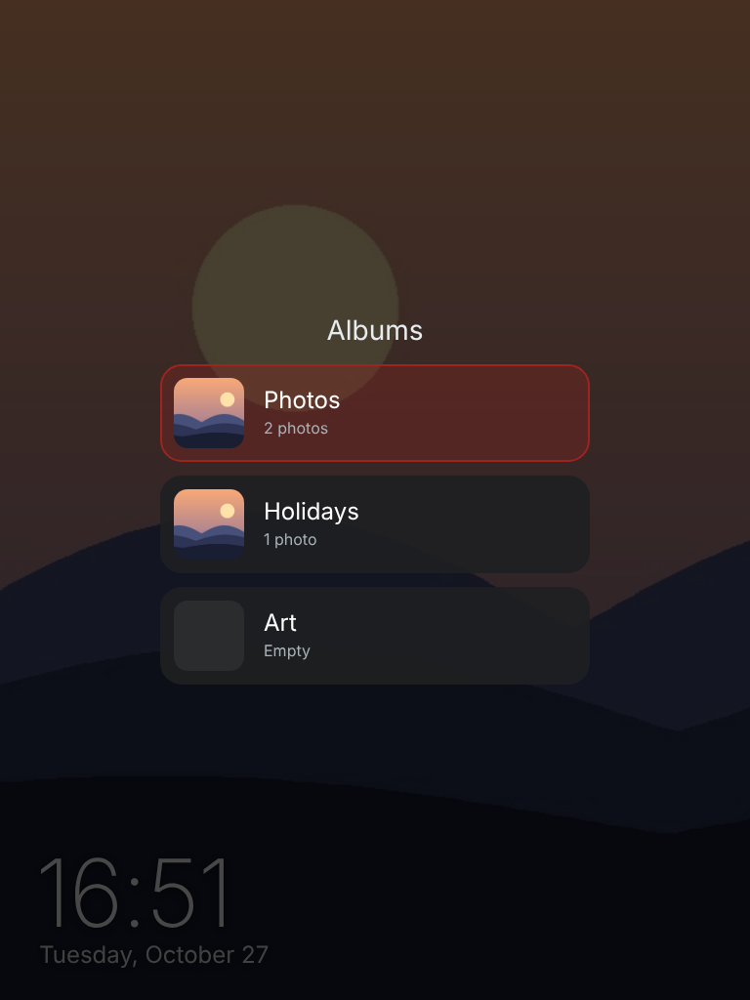

# Picture frame & music player for iPad 1

Turn a **first-generation iPad (iOS 5.1.1)** into a framed wall display for **Home Assistant**. It has three screens and you swipe between them; there are no on-screen buttons for that:

- a flip clock with the weather and the coming days,
- a photo frame with albums,
- a Music Assistant player that looks like a spinning record.

Status banners for a robot vacuum, a washing machine and Alexa timers appear on top of whatever screen is showing.

The original iPad can't run the Home Assistant app or modern dashboards. Its Safari is from 2012: no WebSockets, no `fetch`, no Promises, no flexbox. So every page here is plain HTML with **ES5 JavaScript only**. It talks to Home Assistant over the **REST API** and needs nothing installed on the iPad.

> The UI is in **English** or **Turkish**. By default it follows the iPad's language; set `lang: "en"` or `lang: "tr"` in a page's `CONFIG` to force one.

| Clock, weather and banners | Music (Music Assistant) |
|---|---|
|  |  |
| **Photo frame** | **Albums (double tap)** |
|  |  |

## What's inside

| File | What it does |
|---|---|
| `www/home.html` | The combined app: **Clock · Photos · Music**, switched by swiping. It jumps to the music screen when Music Assistant starts playing and goes back a few minutes after the music stops. It shows banners for a robot vacuum, a washing machine and Alexa timers; while a banner is up, the date on the clock screen steps aside. It reloads itself when the files on the server change. Optional extras: pick the screen from HA, reload the iPad from HA, a status line in HA every minute, and a night blackout. |
| `www/clock.html` | Flip clock: the cards fold over when the time changes. Above it is the date; below it, from top to bottom: a room temperature, the weather (current temperature, condition, today's high and low), sunrise and sunset with a rain warning for the next 12 hours, and a row with the coming days. |
| `www/photos.html` | Photo frame for `/config/www/photos`, changing every 2 minutes with a cross-fade, in shuffled order. Every sub-folder is an **album**: **double-tap** the screen to pick one, or pick it from HA. Wide photos are scaled to the screen height and slowly slide across; portrait photos fill the screen, anchored at the bottom; panoramas are shown whole on a mat colour. Optional clock in the corner. |
| `www/music.html` | Music Assistant player drawn as a turntable. The album cover is the record label and spins while music plays. The tone arm lands on the outer edge of the grooves and moves in to the label as the track plays. It has transport, volume and seek controls, and a library browser (playlists, albums, artists, radio, tracks, search, favourites) that scrolls with one finger. It can also switch on the speaker's smart plug if it is off. |
| `www/index.html` | Launcher. Add **this** page to the home screen (see *Caching* below). `index.html#music`, `#clock` and `#photos` open a single page instead of the combined app. |
| `homeassistant/configuration.yaml` | A `folder` sensor and a `shell_command` for the photos, plus optional helpers. |
| `homeassistant/automations.yaml` | Prepares new photos. An optional second automation shows Alexa timers on the frame instantly. |
| `homeassistant/shell/resize_photos.py` | Scales photos down for the iPad (1024 px, or 1536 px wide for landscape) and turns them upright from their EXIF data. It sorts loose photos into the default album and writes `albums.json`. It uses the Pillow library that ships inside Home Assistant. |

## Setup

1. **Copy the pages.** Put the contents of `www/` into `/config/www/` on your Home Assistant. Home Assistant serves that folder at `http://<ha>:8123/local/`. You can use the Samba share, the File editor add-on, or Studio Code Server.
2. **Edit the `CONFIG` block** at the top of each page so it uses your entity IDs: speaker, plug, vacuum and washer sensors, weather, room temperature. Every option has a comment, and entities you don't have can be left empty.
3. **Token.** Create a long-lived access token: open your **Profile → Security → Long-lived access tokens**. Then either paste it into `token: ""` in the pages, or leave that empty and paste it once into the setup screen that appears on the iPad. The pages share it through `localStorage`.
   **Use a dedicated non-admin user for the token.** Files under `/local/` are served without login, so a token written into a file can be read by anyone who can reach your Home Assistant.
4. **Photos.**
   - Merge `homeassistant/configuration.yaml` into your configuration and restart Home Assistant.
   - Copy `shell/resize_photos.py` to `/config/shell/`. Set `DEFAULT_ALBUM` (and optionally `EXTRA_ALBUMS`) at the top.
   - Add the first automation from `homeassistant/automations.yaml`.
   - Drop JPG or PNG files into `/config/www/photos/<album>/`, or straight into `/config/www/photos/` to put them in the default album. HEIC isn't supported. New photos show up within 5 minutes.
   - The script resizes the photos **in place**, so keep your originals somewhere else.
5. **Optional extras** (helpers are listed in `configuration.yaml`):
   - `home.html` → `screenSelect`: an `input_select` to pick the screen from a dashboard. It works both ways: when you swipe on the iPad, the helper follows.
   - `photos.html` → `albumSelect`: an `input_select` to pick the album. The iPad fills in its options from the album folders.
   - `home.html` → `reloadButton`: an `input_button` that reloads the iPad, handy after you change a file.
   - `home.html` → `status`: an `input_text` the iPad writes to every minute (version, its clock, current screen, timer), so you can see from HA that the frame is alive.
   - `home.html` → `timers`: Alexa timers. Add the second automation and an `input_text`. It reads the duration from Alexa's answer, so the banner shows up seconds after you set a timer.
6. **On the iPad**:
   - Open `http://<ha-ip>:8123/local/index.html` in Safari. Use **http** and the **IP address**: iOS 5 can't connect to modern TLS, so `https://` and Nabu Casa URLs won't work.
   - Tap **Add to Home Screen**.
   - Set **Settings → General → Auto-Lock → Never**.

## Notes

- **Caching.** Home Assistant serves `/local` files with a 31-day browser cache. If you open a page directly, the iPad keeps showing the old copy even after you update the file. `index.html` always opens the real page under a fresh URL, and `home.html` checks every 5 minutes whether any of its files changed and reloads itself if so (or right away with the reload button).
- **The iPad's clock.** iOS 5 has outdated time-zone rules for some countries; Turkey is one example. On those iPads the clock is often set "wrong" so that it shows the right hour. The pages work out the difference from Home Assistant's replies, so countdowns, finish times and sunrise/sunset still come out right.
- **Album art and https.** iOS 5 can't load images from today's https CDNs, such as Spotify covers. The player shows the cover that Home Assistant proxies over http. Library items whose artwork exists only on such CDNs show a placeholder icon.
- **Memory.** The iPad 1 has 256 MB of RAM. That is why the photos are resized and the library thumbnails are loaded lazily at 160 px.
- **Washing machine.** The washer banner was built for a Bosch washer connected through [Home Connect Local](https://github.com/chris-mc1/homeconnect_local_hass). Any integration that reports an operation state (`run`, `pause`, `finished`, …), progress and finish time will work.
- **Battery.** An iPad that stays on the charger all the time sits at 100 %, which wears out an old battery. If you have a smart plug with power metering, you can switch the charger on and off on a schedule.

## Türkçe özet

İlk nesil iPad'i (iOS 5.1.1) Home Assistant için çerçeveli bir duvar ekranına çeviren sayfalar. Ekranı kaydırarak üç ekran arasında geçilir:

- çevirmeli saat; altında oda sıcaklığı, hava durumu, gün doğumu/batımı, yağmur uyarısı ve önümüzdeki günler,
- albümlü fotoğraf çerçevesi; albüm seçmek için ekrana çift dokunulur,
- pikap görünümlü Music Assistant çalar.

Robot süpürge, çamaşır makinesi ve Alexa zamanlayıcısı çalışırken hangi ekran açıksa üstünde durum şeridi belirir.

Arayüz iPad'in diline göre Türkçe ya da İngilizce açılır. Kurulum için `www/` klasörünü `/config/www/` içine kopyalayın, ardından her dosyanın başındaki `CONFIG` bölümüne kendi entity ID'lerinizi yazın. iPad'de Safari ile `http://<HA-IP>:8123/local/index.html` adresini açıp ana ekrana ekleyin.

## License

MIT
