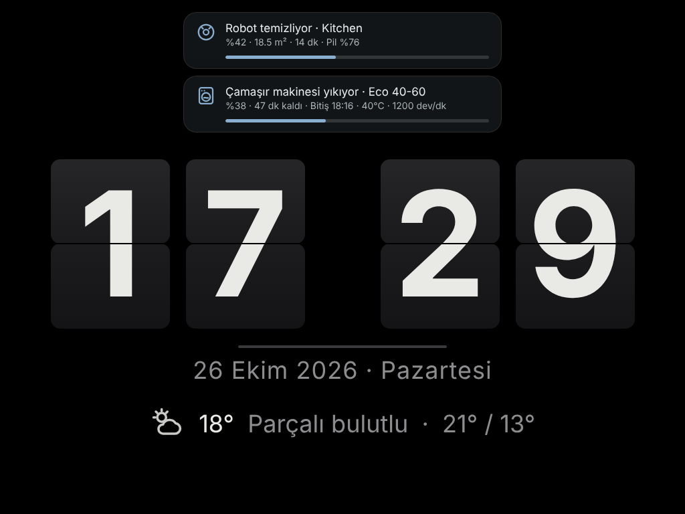
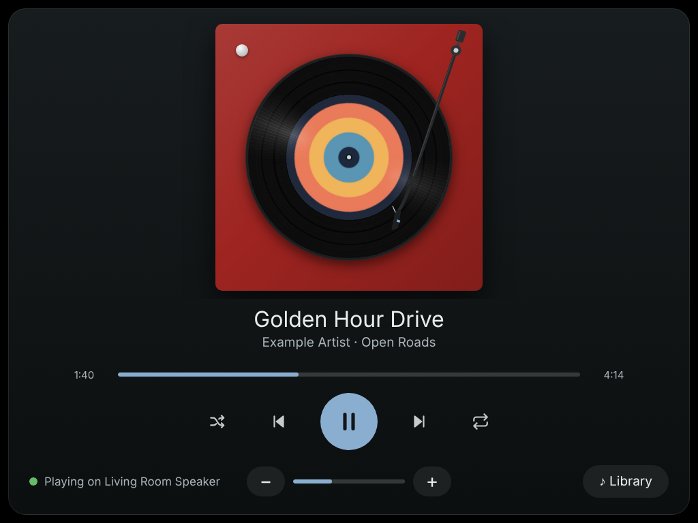
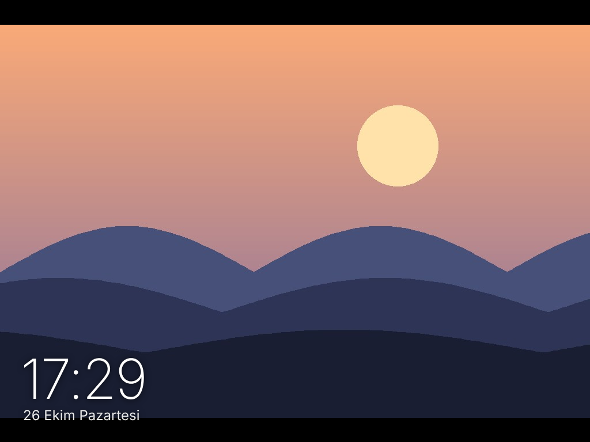
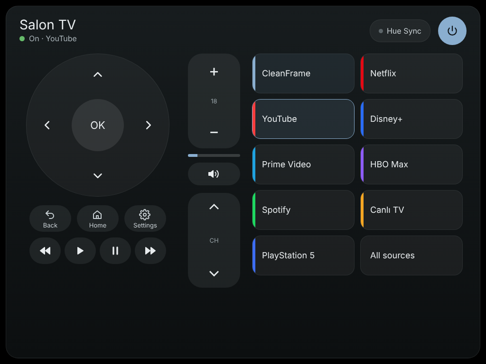

# CleanFrame for iPad 1

Turn a **first-generation iPad (iOS 5.1.1)** into a framed wall display for **Home Assistant**: a flip clock with the weather, a photo frame, and a Music Assistant player that looks like a spinning record. You switch between them by swiping; there are no on-screen buttons for it. Status banners for a robot vacuum and a washing machine appear on top of whatever screen is showing.

The original iPad can't run the Home Assistant app or modern dashboards. Its Safari is from 2012: no WebSockets, no `fetch`, no Promises, no flexbox. So every page here is plain HTML with **ES5 JavaScript only**. It talks to Home Assistant over the **REST API** and needs nothing installed on the iPad.

> UI text is in Turkish. All strings are near the top of each file and are easy to change.

| Clock + weather, with status banners | Music (Music Assistant) |
|---|---|
|  |  |
| **Photo frame** | **TV remote (stand-alone page)** |
|  |  |

## What's inside

| File | What it does |
|---|---|
| `www/home.html` | The combined app. **Clock · Photos · Music**, switched by swiping. It jumps to the music screen when Music Assistant starts playing, and goes back a few minutes after the music stops. It shows robot-vacuum and washing-machine banners, and reloads itself when the files on the server change. |
| `www/clock.html` | Flip clock: the cards fold over when the time changes. Turkish date, plus weather from a `weather.*` entity (current temperature, condition, today's high and low). |
| `www/photos.html` | Photo frame for `/config/www/photos`. It shows pictures in shuffled order, changing every 3 minutes with a cross-fade. Portrait photos are cropped to fill the screen; landscape photos are shown whole. Optional clock in the corner. |
| `www/music.html` | Music Assistant player drawn as a turntable. The album cover is the record label and spins while music plays, and the tone arm moves across the record as the track progresses. It has transport, volume and seek controls, a library browser (playlists, albums, artists, radio, tracks, search and favourites), and can switch on the speaker's smart plug if it is off. |
| `www/remote.html` | LG webOS TV remote: power, D-pad, volume and channel, app shortcuts, all sources, and Hue Sync. Works on its own; it is not part of the combined app. |
| `www/index.html` | Launcher. Add **this** page to the home screen (see *Caching* below). `index.html#music`, `#clock`, `#photos` and `#remote` open a single page instead of the combined app. |
| `homeassistant/configuration.yaml` | A `folder` sensor that lists the photos, and a `shell_command` that shrinks them. |
| `homeassistant/automations.yaml` | Runs the shrinking script when new photos arrive. |
| `homeassistant/shell/resize_photos.py` | Scales photos down to 1024 px and rotates them upright from their EXIF data. It uses the Pillow library that ships inside Home Assistant. |

## Setup

1. **Copy the pages.** Put the contents of `www/` into `/config/www/` on your Home Assistant. Home Assistant serves that folder at `http://<ha>:8123/local/`. You can use the Samba share, the File editor add-on, or Studio Code Server.
2. **Edit the `CONFIG` block** at the top of each page so it uses your entity IDs: speaker, plug, TV, vacuum and washer sensors, weather. Every option has a comment. Entities you don't have can be left empty.
3. **Token.** Create a long-lived access token: open your **Profile → Security → Long-lived access tokens**. Then either paste it into `token: ""` in the pages, or leave that empty and paste it once into the setup screen that appears on the iPad. The pages share it through `localStorage`.
   **Use a dedicated non-admin user for the token.** Files under `/local/` are served without login, so a token written into a file can be read by anyone who can reach your Home Assistant.
4. **Photos (optional).**
   - Merge `homeassistant/configuration.yaml` into your configuration and restart Home Assistant.
   - Copy `shell/resize_photos.py` to `/config/shell/`.
   - Add the automation from `homeassistant/automations.yaml`.
   - Create `/config/www/photos/` and drop JPG or PNG files in it. HEIC isn't supported.
   - The script resizes the photos **in place**, so keep your originals somewhere else.
5. **On the iPad**:
   - Open `http://<ha-ip>:8123/local/index.html` in Safari. Use **http** and the **IP address**: iOS 5 can't connect to modern TLS, so `https://` and Nabu Casa URLs won't work.
   - Tap **Add to Home Screen**.
   - Set **Settings → General → Auto-Lock → Never**.

## Notes

- **Caching.** Home Assistant serves `/local` files with a 31-day browser cache. If you open a page directly, the iPad keeps showing the old copy even after you update the file. `index.html` always opens the real page under a fresh URL, and `home.html` checks every 5 minutes whether any of its files changed and reloads itself if so.
- **Album art and https.** iOS 5 can't load images from today's https CDNs, such as Spotify covers. The player shows the cover that Home Assistant proxies over http. Library items whose artwork exists only on such CDNs show a placeholder icon.
- **Memory.** The iPad 1 has 256 MB of RAM. That is why the photos are resized and the library thumbnails are loaded lazily at 160 px.
- **Washing machine.** The washer banner was built for a Bosch washer connected through [Home Connect Local](https://github.com/chris-mc1/homeconnect_local_hass). Any integration that reports an operation state (`run`, `pause`, `finished`, …), progress and finish time will work.

## Türkçe özet

İlk nesil iPad'i (iOS 5.1.1) Home Assistant için çerçeveli bir duvar ekranına çeviren sayfalar. Ekranı kaydırarak çevirmeli saat ile hava durumu, fotoğraf çerçevesi ve pikap görünümlü Music Assistant çalar arasında geçilir. Robot süpürge ve çamaşır makinesi çalışırken hangi ekran açıksa üstünde durum şeridi belirir.

Kurulum için `www/` klasörünü `/config/www/` içine kopyalayın. Ardından her dosyanın başındaki `CONFIG` bölümüne kendi entity ID'lerinizi yazın. iPad'de Safari ile `http://<HA-IP>:8123/local/index.html` adresini açıp ana ekrana ekleyin.

## License

MIT
